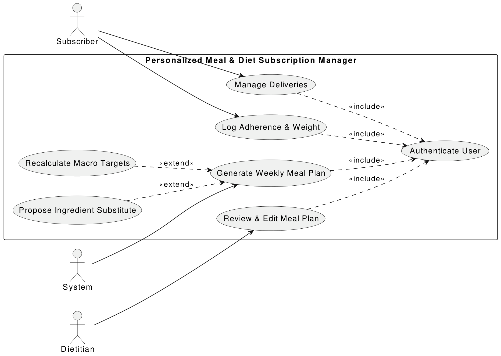
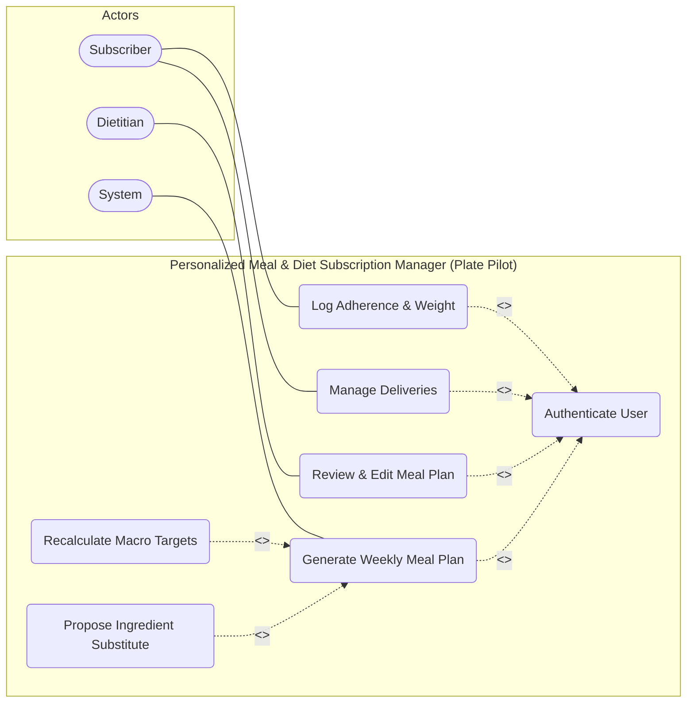

# Lab 2: UML Use-Case Modelling
**Course:** Software Engineering (UE24CS351A)  
**Student SRN:** PES1UG24CS387  
**Problem Statement #19:** Healthcare & Telemedicine (Personalized Meal & Diet Subscription Manager — Plate Pilot)

---

## 1. Actors and Responsibilities

1. **Subscriber (Primary Actor):**
   - Receives customized weekly meal plans.
   - Modifies scheduled deliveries (pause, skip, reschedule).
   - Logs daily dietary adherence and biometric weight logs.
2. **Dietitian (Clinical Actor):**
   - Reviews, edits, and approves auto-generated meal plans before dispatch.
   - Oversees allergy substitutions and medical adherence.
3. **System (Automated Backend / Calculation Engine):**
   - Schedules and triggers automated weekly menu compilation.
   - Recalculates macronutrient targets adaptively based on trend data.
   - Manages ingredient availability and substitution logic.

---

## 2. Use Case Catalog

- **UC-01: Authenticate User** — Enforces identity verification and access permissions.
  - Included by: `UC-02`, `UC-03`, `UC-04`, `UC-05` (`<<include>>`).
- **UC-02: Generate Weekly Meal Plan** — Primary workflow for synthesizing 7-day nutritional plans.
- **UC-03: Manage Deliveries** — Pause, skip, or reschedule daily shipments up to 12h cutoff.
- **UC-04: Log Adherence & Weight** — Submits biometric progress updates for feedback loops.
- **UC-05: Review & Edit Meal Plan** — Dietitian clinical validation and plan sign-off.
- **UC-06: Recalculate Macro Targets** — `<<extend>>` `UC-02` when historical weight trends require target re-tuning.
- **UC-07: Propose Ingredient Substitute** — `<<extend>>` `UC-02` triggered during inventory stockouts.

---

## 3. UML Use-Case Diagram



### Mermaid Flowchart Representation


---

## 4. Use-Case Flow Specification

### **Core Use Case:** `UC-02: Generate Weekly Meal Plan`

#### **Preconditions:**
1. The subscriber has an active subscription and a completed clinical health profile (allergens, diabetic limits, macro goals).
2. The system is authenticated and authorized to access subscriber medical records.
3. Inventory stock and recipe nutritional data are up to date.

#### **Postconditions:**
1. A customized 7-day meal plan is generated and persisted with status `"Pending Review"`.
2. The assigned dietitian is alerted for clinical sign-off.

#### **Main Success Scenario:**
1. The scheduled generation timestamp is reached for a subscriber.
2. System securely queries subscriber macronutrient goals and allergen exclusion list (`<<include>> UC-01`).
3. System fetches biometric logs (weight trend and past week adherence).
4. System recalculates target macros (`<<extend>> UC-06: Recalculate Macro Targets`).
5. System filters recipe catalog, rejecting any recipe containing excluded allergens.
6. System compiles safe, macro-compliant recipes into a 7-day schedule.
7. System persists the generated plan in state `"Pending Review"`.
8. System dispatches a review notification to the assigned Dietitian.

#### **Alternate Flow: Ingredient Unavailable (Step 5)**
- **5a.** A required ingredient is marked out-of-stock in inventory.
  1. System detects stock deficit.
  2. System initiates `<<extend>> UC-07: Propose Ingredient Substitute`.
  3. System identifies an equivalent substitute strictly matching allergen and macro constraints.
  4. System flags substitution for dietitian verification.
  5. System resumes at Step 6 of the Main Success Scenario.

---

## 5. Deliverables Included

1. `use_case_diagram.png` — High-resolution rendered use-case diagram.
2. `use_case_diagram.pdf` — Original vector PDF submission artifact.
3. `use_case_diagram.mermaid` — Source code for the diagram.
4. `test_use_cases.py` — Pytest validation exercising all actors, use-case flows, includes, and extends.

---

## 6. How to Execute Tests

```bash
cd "Lab 2"
pytest test_use_cases.py -v
```
