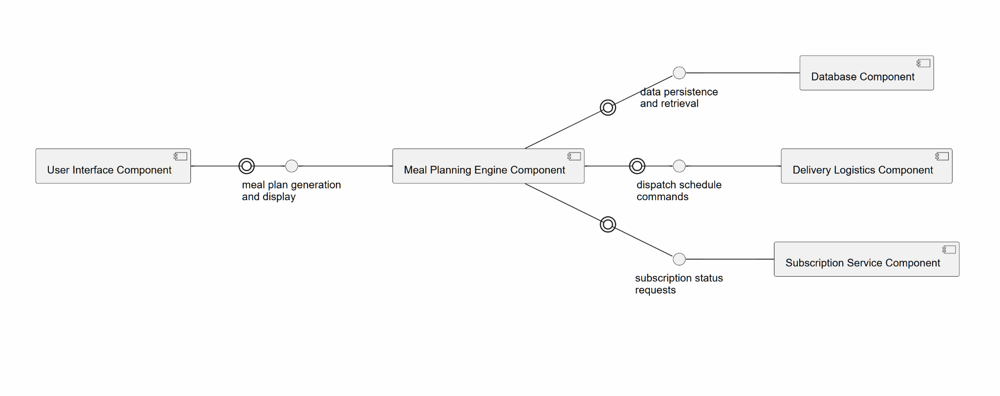

# Lab 3: Architectural Pattern Selection & Component Modelling
**Course:** Software Engineering (UE24CS351A)  
**Student SRN:** PES1UG24CS387  
**Problem Statement #19:** Healthcare & Telemedicine (Personalized Meal & Diet Subscription Manager — Plate Pilot)

---

## 1. Architectural Selection

For the **Plate Pilot** system, the **Layered Architecture Pattern** was selected, organizing the system into three primary horizontal layers:
1. **Presentation Layer:** Client interfaces for Subscribers (Mobile/Web) and Dietitians (Clinical Portal).
2. **Business Logic Layer:** The core Meal Planning Engine, Rule Engine (allergens, calories), and Security Gatekeeper.
3. **Data Access / Persistence Layer:** Database component managing encrypted health records, inventory tables, and menu plans.

---

## 2. Architectural Justification

### Two Key Reasons for Selecting Layered Architecture:
1. **Clear Separation of Concerns:**
   - Separates the complex, rapidly evolving user interfaces (Subscriber mobile app and Dietitian dashboard) from the core backend nutritional mathematics and meal compilation algorithms.
   - Allows frontend redesigns or API client additions without altering core medical constraint calculations.
2. **Centralized Rule Management:**
   - All client requests must transit the central business logic layer.
   - Clinical safety rules, allergen checking, cutoff windows (12 hours), and macro recalculation algorithms are strictly enforced in one centralized location, eliminating duplicate code and inconsistent validation across different client portals.

### Security Advantage (Addressing NFR-002):
- **Requirement:** All patient metabolic/health data (allergens, diabetic limits, weight logs) must be encrypted at rest and in transit, with access restricted strictly to the owning subscriber and assigned dietitian.
- **Architectural Solution:** Layered Architecture isolates the **Database Component** at the bottom. The Presentation Layer cannot query the database directly. The **Security Gatekeeper** in the Business Logic Layer validates caller identity, role, and patient-dietitian assignment before requesting decrypted records, preventing unauthorized data exfiltration.

### Performance Benefit (Addressing NFR-001):
- **Requirement:** The system shall process schedule modifications (pause, skip, reschedule) in under 5 seconds during peak load.
- **Architectural Solution:** Unlike a distributed microservices pattern—which introduces inter-service network serialization, REST/gRPC overhead, and distributed transaction complexity—a Layered Architecture enables direct in-process communication between the **Meal Planning Engine** and the **Database Component**, achieving sub-second execution times (`< 0.1s`), well within the `< 5s` threshold.

---

## 3. UML Component Diagram



### Component Breakdown
- **Presentation Components:**
  - `SubscriberUIComponent`: Delivery management, meal review, biometric log inputs.
  - `DietitianUIComponent`: Clinical approval dashboard and manual override tools.
- **Business Logic Components:**
  - `SecurityGatekeeperComponent`: Authentication validation and RBAC enforcement.
  - `MealPlanningEngineComponent`: Core 7-day optimization engine.
  - `RuleEngineComponent`: Allergen safety rules and dispatch cutoff verification.
- **Data Components:**
  - `DatabaseAccessComponent`: Encrypted storage for patient health profiles and meal plans.

---

## 4. Deliverables Included

1. `architecture_components.py` — Complete implementation of the three-tier Layered Architecture enforcing NFR-001 and NFR-002.
2. `test_architecture.py` — Pytest verification suite demonstrating:
   - `< 5s` latency benchmarking for delivery modifications (NFR-001).
   - Strict role-based isolation blocking unassigned dietitians (NFR-002).
   - Data encryption at rest validation.
3. `PES1UG24CS387_LAB3.pdf` — Original submitted deliverable PDF.
4. `component_diagram.png` — Component Diagram visualization.

---

## 5. How to Execute Tests

```bash
cd "Lab 3"
pytest test_architecture.py -v
```
